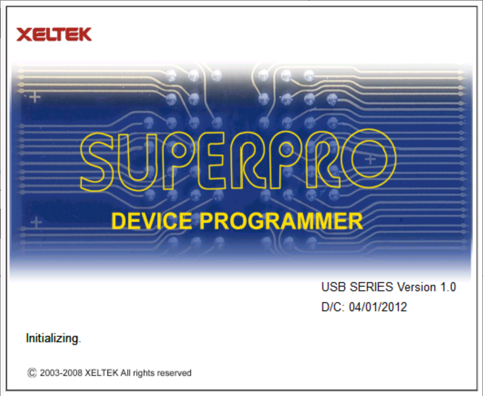

# Xeltek SUPERPRO 9000U on Windows 11

## Start here: downloads and exact file locations

**Download or clone this entire repository first. Extract the GitHub ZIP before
running anything.** The project root is the folder containing this `README.md`
and `Prepare-Software.cmd`. All paths below are relative to that folder.

### 1. What you must download

| Download | Exact location | Required? |
| --- | --- | --- |
| [Original Xeltek nsp9kw.exe](https://www.xeltek.com/software/sp9000u/nsp9kw.exe) | `downloads/nsp9kw.exe` | Yes, the original application, firmware and device libraries |
| [Python for Windows](https://www.python.org/downloads/windows/), version 3.10 or newer | Install Python normally in Windows; do not copy the installer into this project | Yes, used once to prepare the vendor software; enable the Python launcher or add Python to PATH |
| [Original manual](https://www.xeltek.com/software/sp9000u/SP9K-Manual.pdf) | `downloads/SP9K-Manual.pdf` | Optional reference only |

If you already have `nsp9kw-202005261414.zip`, place it at
`downloads/nsp9kw-202005261414.zip` **instead of** `downloads/nsp9kw.exe`.
Keep exactly one of these two vendor packages in `downloads/`. The preparation
script supports both formats. Leave the original installer unopened; the script
reads its archive contents without running it.

**No compiler, Visual Studio, WDK, pip package or separate WinUSB download is
needed for normal installation.** The custom tools are already included, and
Microsoft WinUSB is part of Windows 11.

### 2. Files already included: keep these exact locations

| File | Exact location relative to the project root |
| --- | --- |
| Preparation launcher | `Prepare-Software.cmd` |
| Preparation script | `prepare.py` |
| Archive extraction helper | `extract_xeltek.py` |
| Python helper modules | Keep the entire supplied `native/` directory |
| USB setup launcher | `Windows11-Native/Setup-USB.exe` |
| Driver setup helper | `Windows11-Native/XeltekUsbSetup.exe` |
| Application launcher | `Windows11-Native/Start-SUPERPRO.exe` |
| 32-bit USB bridge | `Windows11-Native/SP9000U/bin/xusb32.dll` |

Do not move an EXE or DLL out of this layout. Downloading only individual source
files from GitHub is insufficient; use the complete repository ZIP or a clone.

### 3. Prepare the original software

Double-click **`Prepare-Software.cmd` in the project root**. Alternatively, open
a terminal in that folder and run:

```powershell
py -3 .\prepare.py
```

The script finds the vendor package in `downloads/`, extracts all three inner
archives and generates the adapted executable. It requires only Python's
standard library. You do not need to move individual vendor files manually.

| Original archive / file | Destination created automatically |
| --- | --- |
| `USBBIN.ZIP` -> `USBBIN.DAT` -> application files, DLLs and firmware | `Windows11-Native/SP9000U/bin/` |
| Original `sp9000.exe` | `Windows11-Native/SP9000U/bin/sp9000.exe` |
| Adapted executable generated from that original | `Windows11-Native/SP9000U/bin/sp9000-win11.exe` |
| `USBLIB.ZIP` -> `USBLIB.DAT` -> every device library file | `Windows11-Native/SP9000U/lib/` |
| `USBALGO9.ZIP` -> `USBALGO9.DAT` -> every algorithm file | `Windows11-Native/SP9000U/algo9/` |
| Settings created by the application launcher | `Windows11-Native/SP9000U/bin/agspedit.ini` |
| Shared setup, preparation and runtime log | `Windows11-Native/SP9000U/bin/superpro9000u.log` |

Before preparation, `bin/` contains the supplied `xusb32.dll`; the original
application and `lib/` and `algo9/` folders are intentionally not distributed.
After preparation, the relevant layout is:

```text
project-root/
  Prepare-Software.cmd
  prepare.py
  extract_xeltek.py
  native/                         keep all supplied Python helper modules
  downloads/
    nsp9kw.exe                    the one vendor package you download
    SP9K-Manual.pdf                optional
  Windows11-Native/
    Setup-USB.exe
    XeltekUsbSetup.exe
    Start-SUPERPRO.exe
    SP9000U/
      bin/
        xusb32.dll                supplied compatibility bridge
        sp9000.exe                extracted original
        sp9000-win11.exe          generated adapted application
        ...                       all other extracted bin files
        agspedit.ini              created by the launcher
        superpro9000u.log          created automatically
      lib/
        ...                       all extracted device library files
      algo9/
        ...                       all extracted algorithm files
```

### 4. Connect and start

Insert a CF card in module 1 before switching on the programmer. Connect power
and USB. Run **`Windows11-Native/Setup-USB.exe` once**, accept the administrator
prompt, then use **`Windows11-Native/Start-SUPERPRO.exe`** for normal launches.
The application should report `Ready` without `Demo mode`.


Native WinUSB compatibility layer for the original SUPERPRO 9000U software on
64-bit Windows 11. The original 32-bit application communicates with Microsoft's
WinUSB driver through a small USB bridge. No virtual machine is required.

## Screenshots

<p align="center">
  
  
</p>

## Status

Tested on Windows 11 Pro x64, build 26200, with a physical SUPERPRO 9000U on
November 13, 2026:

| Function | Result |
| --- | --- |
| Microsoft WinUSB installation | Passed |
| USB interface registration and device restart | Passed |
| Device descriptors and six bulk endpoints | Passed |
| Firmware upload and USB communication | Passed |
| Original application initialization | `Ready`, no Demo mode, module 1 green |
| Modules 2, 3 and 4 | Not tested; inactive during verification |
| Chip read, erase, program and verify | Not tested |

This is an experimental compatibility project. Successful initialization does
not establish that every chip operation or programmer module works correctly.

## Quick start

Use the generated `Windows11-Native` folder as a complete package. Keep its
`SP9000U` subfolder beside the launchers.

1. Insert at least one CF card in module 1 before powering on the programmer.
2. Connect its power supply and USB cable, then switch it on. Leave the sockets
   empty for the initial connection test.
3. Disconnect other Xeltek programmers. The legacy USB IDs are not unique to
   this model.
4. Run `Setup-USB.exe` and accept the Windows administrator prompt. Setup selects
   the existing Microsoft WinUSB driver and restarts only the matching USB device.
5. Run `Start-SUPERPRO.exe` using a normal user account.
6. Check that the application reports `Ready` without `Demo mode`.

If setup reports that the device could not be restarted, unplug and reconnect
its USB cable. If firmware startup exposes the other USB ID, close the
application and run setup again for that device state.

Without a connected programmer, choose `Cancel` at `Programmer not found` to
open the original interface in Demo mode.

## One shared log

All custom components append to one UTF-8 file beside the programmer executable:

```text
Windows11-Native/SP9000U/bin/superpro9000u.log
```

The file includes setup output, launcher events, USB opens and closes, endpoint
information, every USB IOCTL result, warnings, errors, build output and test
results. Each record contains a UTC timestamp, severity, component, process and
thread IDs, and a Windows error code. Error descriptions use English.

```text
2026-11-13T10:00:00.000Z [INFO] [usb-bridge] pid=1234 tid=5678 error=0 operation=open code=0x00000000 length=0 result=1
2026-11-13T10:00:01.000Z [ERROR] [usb-setup] pid=1234 tid=5678 error=87 Setup failed. | The parameter is incorrect.
```

Repeated runs append to the existing file. Processes use a shared file lock to
prevent interleaved records. Firmware and chip data are not included. The
original application's on-screen messages and Windows' own system logs remain
separate from this custom diagnostic log. Logging self-tests deliberately emit
synthetic errors under `logging-test`.

Keep the software folder writable. No fallback log is created elsewhere.
Previous custom logs are imported into the shared file when migrating an
existing local installation. Logs are excluded from Git.

## Command-line diagnostics

Run these from `Windows11-Native`:

```powershell
.\XeltekUsbSetup.exe --list
.\XeltekUsbSetup.exe --check-driver
.\XeltekUsbSetup.exe --check-device-driver
```

These commands inspect devices or driver lists without installing anything.
`--install` performs setup with a result dialog; `--install-console` performs the
same operation without that dialog. Both installation commands require an
elevated terminal. `Setup-USB.exe` requests elevation automatically.

## Build from source

This section is only for developers rebuilding the included tools. End users
should follow the preparation instructions at the top instead.

Requirements:

- Windows 11 x64.
- Python 3.10 or newer and `pefile`.
- [LLVM-MinGW](https://github.com/mstorsjo/llvm-mingw), with i686 and x86_64
  compilers. The local build uses version 20261104, UCRT x86_64 distribution.
- The original Xeltek 9000U software package.

Extract the complete LLVM-MinGW distribution into
`Analysis/toolchain/llvm-mingw-20261104-ucrt-x86_64/`, so both
`bin/i686-w64-mingw32-clang.exe` and `bin/x86_64-w64-mingw32-clang.exe` exist
inside it. Keep its include and library directories as well.

With the vendor package at `downloads/nsp9kw.exe`:

```powershell
python -m pip install -r .\requirements-build.txt
python .\extract_xeltek.py --archive .\downloads\nsp9kw.exe
python .\native\build.py --toolchain .\Analysis\toolchain\llvm-mingw-20261104-ucrt-x86_64
```

Close the programmer application before rebuilding so the DLL can be replaced.
The build preserves the vendor files, checks their hashes, builds both process
architectures where appropriate, validates all 146 proxy exports, and runs the
required tests. Output goes into `Windows11-Native`; compiler output and errors
go into the same shared log as the runtime tools.

The compatibility bridge is x86 because the original application is x86. The
setup helper and launchers are x64. The kernel USB driver is Microsoft's existing
WinUSB driver; this project does not provide a custom kernel binary.

## Tests

| Test | Coverage |
| --- | --- |
| `Transport-SelfTest-x86.exe` / `Transport-SelfTest-x64.exe` | Pipe mapping, USB setup packets, short transfers, errors, firmware chunking and input bounds using a mock transport |
| `Bridge-SelfTest-x86.exe` | Real DLL loading, KERNEL32 forwarding, ordinary file I/O and read-only USB open/close |
| `Logging-SelfTest-x86.exe` / `Logging-SelfTest-x64.exe` | UTF-8, success and error records, Windows last-error preservation |
| Build concurrency test | 600 records from six simultaneous x86/x64 processes, checked for missing, duplicate or interleaved records |
| `XeltekUsbSetup.exe --selftest-selection` | Reproduces error 87 with a global driver node, then verifies device-specific selection on an unregistered in-memory device element |

The driver-selection regression test requires administrator privileges and
returns exit code 77 when skipped. It never registers or installs a test device.
Build/test results are written to `build-report.json`; previous physical-device
verification is preserved separately in `hardware-verification.json`.

## Troubleshooting

- **Device not found:** check power, the USB cable, and the CF card in module 1.
  Run `--list` and confirm the driver is `WINUSB`.
- **Multiple matching devices:** leave only the intended 9000U connected.
- **Error 87 during installation:** use the current setup helper. It selects a
  driver node from the target device's own driver list.
- **WinUSB installed but application cannot connect:** rerun setup to register
  the interface GUID in the correct hardware key and restart the device.
- **Access denied:** use `Setup-USB.exe`; keep the software folder writable for
  normal application use and logging.

For a bug report, include the Windows version, the last operation performed and
the relevant part of `superpro9000u.log`. Review device identifiers and local
paths before sharing logs publicly.

## Project layout

```text
README.md                     Download and placement instructions first
Prepare-Software.cmd          End-user preparation launcher
prepare.py                    Standard-library vendor preparation
downloads/                    User-supplied vendor package and optional manual
docs/images/                  Startup and Ready screenshots
extract_xeltek.py              Original ZIP/DAT archive extractor
native/src/                   Bridge, setup, launchers and shared logger
native/tests/                 Transport, integration and logging tests
native/build.py               Build and validation script
native/ANALYSIS.md             Reverse-engineering notes and limitations
Original-Setup/               Local vendor setup files
SP9000U/                      Extracted vendor application and libraries
Analysis/                     Local analysis data and compiler toolchain
Windows11-Native/             Included custom binaries; vendor data added locally
```

Vendor packages, manuals, extracted vendor binaries, compiler downloads and
runtime logs are excluded from source control. Only the four custom runtime
binaries are included. Obtain the original software from
[Xeltek](https://www.xeltek.com/software/sp9000u/).

See [the technical analysis](native/ANALYSIS.md) for implementation details and
the reconstructed IOCTL interface.
