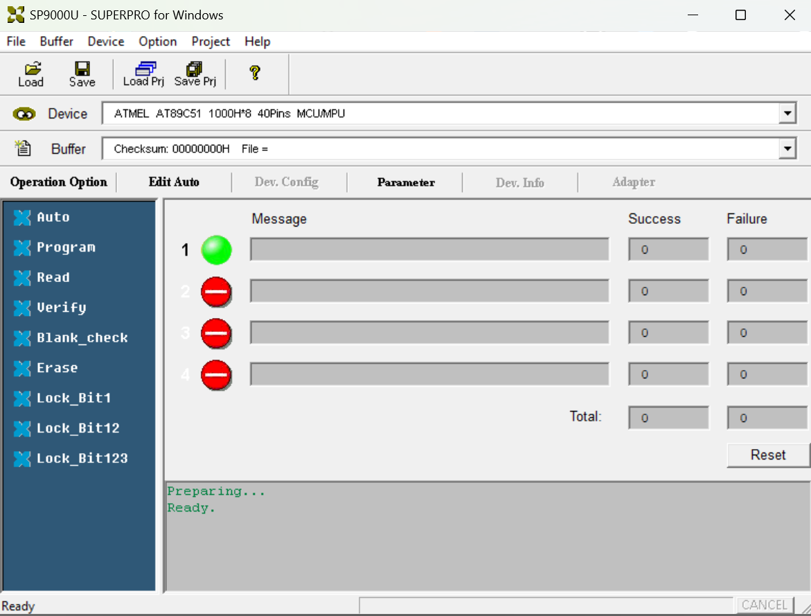

# Xeltek SUPERPRO 9000U on Windows 11

<p align="center">
  
</p>

## Start here: downloads and file locations

<p><br></p>

> [!WARNING]
> **PROGRAMMER MUST BE SWITCHED OFF UNTIL THIS MANUAL TELLS YOU TO SWITCH IT ON.**
>
> **DO NOT INSERT A CF CARD OR EPROM.**

**Clone this entire repository first.**

The project root is the folder containing this `README.md`
and `Prepare-Software.cmd`. All paths below are relative to that folder.

<p><br></p>
<p><br></p>

### 1. What you must download externally

| Download | Exact location |
| --- | --- |
| [Original Xeltek SUPERPRO 9000U ZIP](https://www.xeltek-cn.com/getfile/sp9000u) | `downloads/nsp9kw-202005261414.zip` *: see below if you can't find the ZIP|
| [Python for Windows](https://www.python.org/downloads/windows/), version 3.10 or newer | Install Python normally in Windows; do not copy the installer into this project |

Download the original ZIP package and save it as
**`downloads/nsp9kw-202005261414.zip`**.

If the official download is no longer available, search for that exact filename
in a web archive, such as the Internet Archive.

**Leave the ZIP file intact. Do not unpack it manually.** The preparation script
extracts the required files automatically without running the original installer.

*:
> [!NOTE]
> If you can only find `nsp9kw.exe`, save it as **`downloads/nsp9kw.exe`** and leave
> it unopened. Run **`Prepare-Software.cmd`** as usual; the script also supports
> this self-extracting archive. Keep only one package in `downloads/`: either
> the ZIP or the EXE, not both.

<p><br></p>
<p><br></p>


### 2. What did I download?

| File | Exact location relative to the project root |
| --- | --- |
| Preparation launcher | `Prepare-Software.cmd` |
| Preparation script | `prepare.py` |
| Archive extraction helper | `extract_xeltek.py` |
| Python helper modules | Keep the entire supplied `native/` directory |
| USB setup launcher | `Windows11-Native/Setup-USB.exe` |
| Driver setup helper | `Windows11-Native/XeltekUsbSetup.exe` |
| Application launcher | `Windows11-Native/Start-SUPERPRO.exe` |
| 32-bit USB bridge | `Windows11-Native/SP9000U/bin/xusb32.dll` |

Do not move an EXE or DLL out of this layout. Downloading only individual source
files from GitHub is insufficient; use the complete repository ZIP or a clone.

<p><br></p>
<p><br></p>


### 3. Prepare the original software

Double-click **`Prepare-Software.cmd` in the project root**. Alternatively, open
a terminal in that folder and run:

```powershell
py -3 .\prepare.py
```

The script finds the vendor package in `downloads/`, extracts all three inner
archives and generates the adapted executable. It requires only Python's
standard library. You do not need to move individual vendor files manually.

| Original archive / file | Destination created automatically |
| --- | --- |
| `USBBIN.ZIP` -> `USBBIN.DAT` -> application files, DLLs and firmware | `Windows11-Native/SP9000U/bin/` |
| Original `sp9000.exe` | `Windows11-Native/SP9000U/bin/sp9000.exe` |
| Adapted executable generated from that original | `Windows11-Native/SP9000U/bin/sp9000-win11.exe` |
| `USBLIB.ZIP` -> `USBLIB.DAT` -> every device library file | `Windows11-Native/SP9000U/lib/` |
| `USBALGO9.ZIP` -> `USBALGO9.DAT` -> every algorithm file | `Windows11-Native/SP9000U/algo9/` |
| Settings created by the application launcher | `Windows11-Native/SP9000U/bin/agspedit.ini` |
| Shared setup, preparation and runtime log | `Windows11-Native/SP9000U/bin/superpro9000u.log` |

Before preparation, `bin/` contains the supplied `xusb32.dll`; the original
application and `lib/` and `algo9/` folders are intentionally not distributed.
After preparation, the relevant layout is:

```text
project-root/
  Prepare-Software.cmd
  prepare.py
  extract_xeltek.py
  native/                         keep all supplied Python helper modules
  downloads/
    nsp9kw.exe                    the one vendor package you download
    SP9K-Manual.pdf                optional
  Windows11-Native/
    Setup-USB.exe
    XeltekUsbSetup.exe
    Start-SUPERPRO.exe
    SP9000U/
      bin/
        xusb32.dll                supplied compatibility bridge
        sp9000.exe                extracted original
        sp9000-win11.exe          generated adapted application
        ...                       all other extracted bin files
        agspedit.ini              created by the launcher
        superpro9000u.log          created automatically
      lib/
        ...                       all extracted device library files
      algo9/
        ...                       all extracted algorithm files
```

<p><br></p>
<p><br></p>


### 4. Connect and start

1. Insert a CF card in module 1.
2. Connect power and USB.
3. Switch on the programmer and wait a few seconds.
4. Run **`Windows11-Native/Setup-USB.exe` once** and accept the administrator prompt.

<p><br></p>
<p><br></p>


### 5. You're done!

From now on use **`Windows11-Native/Start-SUPERPRO.exe`** for normal launches.

<p><br></p>
<p><br></p>


<p><br></p>
<p><br></p>


## How it works

The original 32-bit application communicates with Microsoft's
WinUSB driver through a small USB bridge.

## Log

All custom components append to one log beside the programmer executable:

```text
Windows11-Native/SP9000U/bin/superpro9000u.log
```

## Command-line diagnostics

Run these from `Windows11-Native`:

```powershell
.\XeltekUsbSetup.exe --list
.\XeltekUsbSetup.exe --check-driver
.\XeltekUsbSetup.exe --check-device-driver
```

These commands inspect devices or driver lists without installing anything.
`--install` performs setup with a result dialog; `--install-console` performs the
same operation without that dialog. Both installation commands require an
elevated terminal. `Setup-USB.exe` requests elevation automatically.

## Build from source

This section is only for developers rebuilding the included tools. End users
should follow the preparation instructions at the top instead.

Requirements:

- Windows 11 x64.
- Python 3.10 or newer and `pefile`.
- [LLVM-MinGW](https://github.com/mstorsjo/llvm-mingw), with i686 and x86_64
  compilers. The local build uses version 20261104, UCRT x86_64 distribution.
- The original Xeltek 9000U software package.

Extract the complete LLVM-MinGW distribution into
`Analysis/toolchain/llvm-mingw-20261104-ucrt-x86_64/`, so both
`bin/i686-w64-mingw32-clang.exe` and `bin/x86_64-w64-mingw32-clang.exe` exist
inside it. Keep its include and library directories as well.

With the vendor package at `downloads/nsp9kw.exe`:

```powershell
python -m pip install -r .\requirements-build.txt
python .\extract_xeltek.py --archive .\downloads\nsp9kw.exe
python .\native\build.py --toolchain .\Analysis\toolchain\llvm-mingw-20261104-ucrt-x86_64
```

Close the programmer application before rebuilding so the DLL can be replaced.
The build preserves the vendor files, checks their hashes, builds both process
architectures where appropriate, validates all 146 proxy exports, and runs the
required tests. Output goes into `Windows11-Native`; compiler output and errors
go into the same shared log as the runtime tools.

The compatibility bridge is x86 because the original application is x86. The
setup helper and launchers are x64. The kernel USB driver is Microsoft's existing
WinUSB driver; this project does not provide a custom kernel binary.

## Tests

| Test | Coverage |
| --- | --- |
| `Transport-SelfTest-x86.exe` / `Transport-SelfTest-x64.exe` | Pipe mapping, USB setup packets, short transfers, errors, firmware chunking and input bounds using a mock transport |
| `Bridge-SelfTest-x86.exe` | Real DLL loading, KERNEL32 forwarding, ordinary file I/O and read-only USB open/close |
| `Logging-SelfTest-x86.exe` / `Logging-SelfTest-x64.exe` | UTF-8, success and error records, Windows last-error preservation |
| Build concurrency test | 600 records from six simultaneous x86/x64 processes, checked for missing, duplicate or interleaved records |
| `XeltekUsbSetup.exe --selftest-selection` | Reproduces error 87 with a global driver node, then verifies device-specific selection on an unregistered in-memory device element |

The driver-selection regression test requires administrator privileges and
returns exit code 77 when skipped. It never registers or installs a test device.
Build/test results are written to `build-report.json`; previous physical-device
verification is preserved separately in `hardware-verification.json`.

## Troubleshooting

- **Device not found:** check power, the USB cable, and the CF card in module 1.
  Run `--list` and confirm the driver is `WINUSB`.
- **Multiple matching devices:** leave only the intended 9000U connected.
- **Error 87 during installation:** use the current setup helper. It selects a
  driver node from the target device's own driver list.
- **WinUSB installed but application cannot connect:** rerun setup to register
  the interface GUID in the correct hardware key and restart the device.
- **Access denied:** use `Setup-USB.exe`; keep the software folder writable for
  normal application use and logging.

For a bug report, include the Windows version, the last operation performed and
the relevant part of `superpro9000u.log`. Review device identifiers and local
paths before sharing logs publicly.

## Project layout

```text
README.md                     Download and placement instructions first
Prepare-Software.cmd          End-user preparation launcher
prepare.py                    Standard-library vendor preparation
downloads/                    User-supplied vendor package and optional manual
docs/images/                  Startup and Ready screenshots
extract_xeltek.py              Original ZIP/DAT archive extractor
native/src/                   Bridge, setup, launchers and shared logger
native/tests/                 Transport, integration and logging tests
native/build.py               Build and validation script
native/ANALYSIS.md             Reverse-engineering notes and limitations
Original-Setup/               Local vendor setup files
SP9000U/                      Extracted vendor application and libraries
Analysis/                     Local analysis data and compiler toolchain
Windows11-Native/             Included custom binaries; vendor data added locally
```

Vendor packages, manuals, extracted vendor binaries, compiler downloads and
runtime logs are excluded from source control. Only the four custom runtime
binaries are included. Obtain the original software from
[Xeltek](https://www.xeltek.com/software/sp9000u/).

See [the technical analysis](native/ANALYSIS.md) for implementation details and
the reconstructed IOCTL interface.
